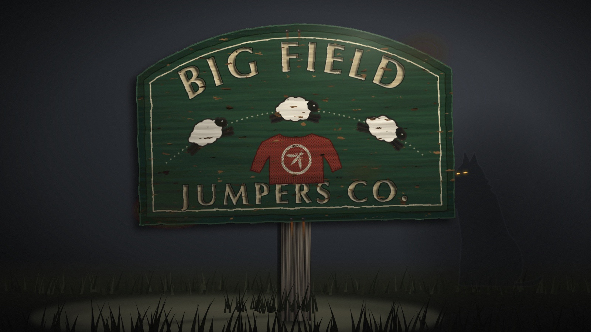

# Before you begin

*Illustration: AI-generated, then edited.*

Every lab in HACTU8 happens at Big Field Jumpers Co., to the same assistant and the same handful of people. The labs show what goes wrong. These pages show who the people are and why they let an AI into the business.

There are no spoilers. You will know the characters before you meet them in a lab, but not what is about to happen to them. It takes about five minutes to read.

1. [Big Field](01-big-field.md): the farm and how it got its name.
2. [Too much paper](02-too-much-paper.md): how a small farm ended up with more inboxes than sheep.
3. [A lamb at the gate](03-a-lamb-at-the-gate.md): the assistant arrives.
4. [The people of Big Field](04-the-people.md): who they are and what each of them is hoping for.
5. [Something at the edge of the field](05-the-wolf.md): the one who is not on the payroll.
6. [The year ahead](06-the-year-ahead.md): where the labs pick up the story.

> Big Field Jumpers Co., its people, its suppliers and its customers are fictional. The domain `bigfield.example` is reserved for examples and does not exist.
